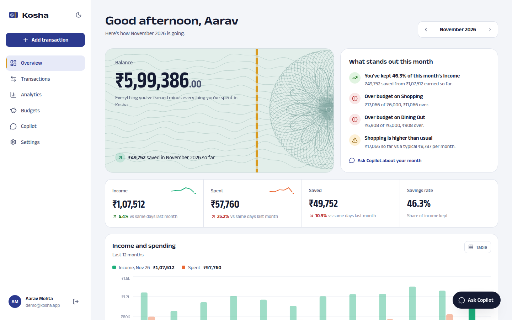
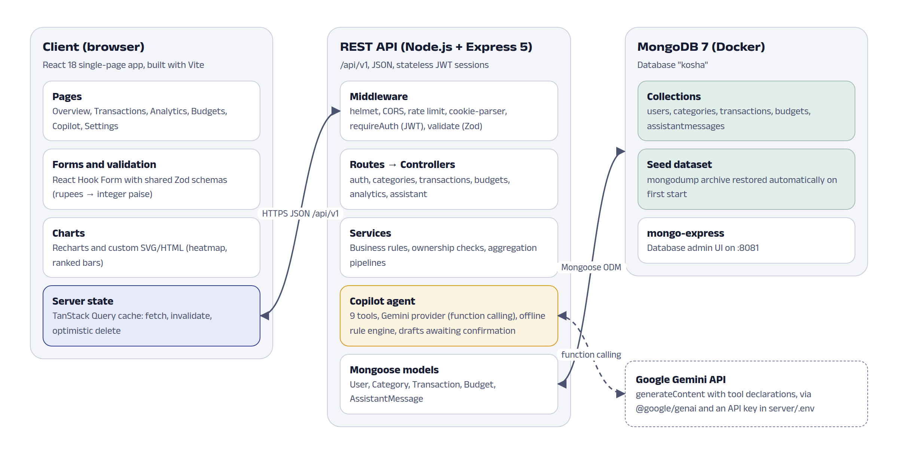
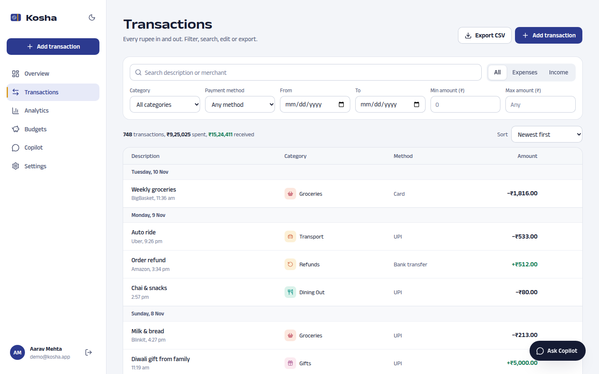
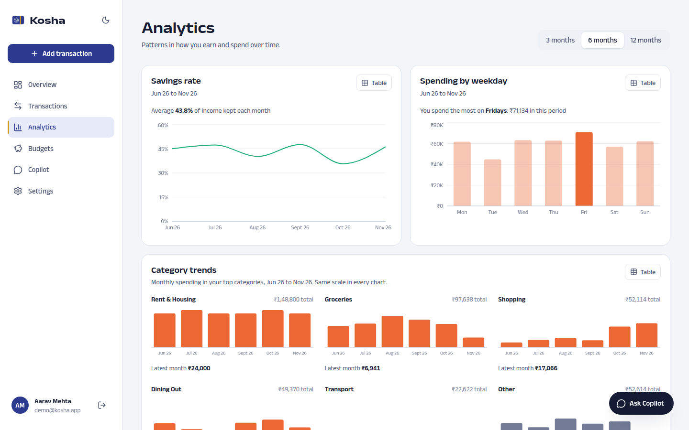
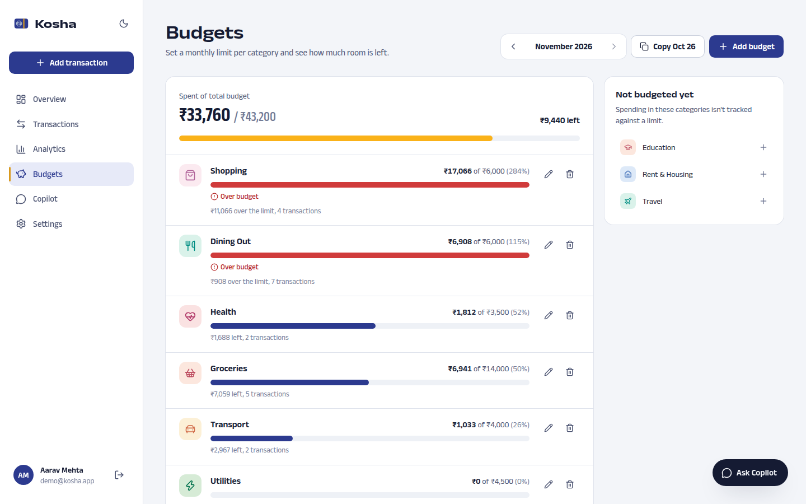
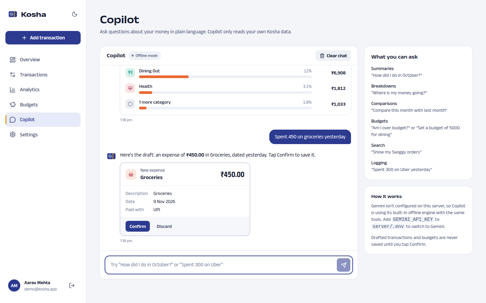
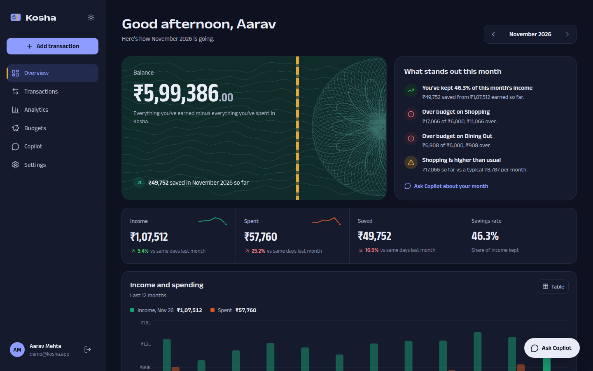
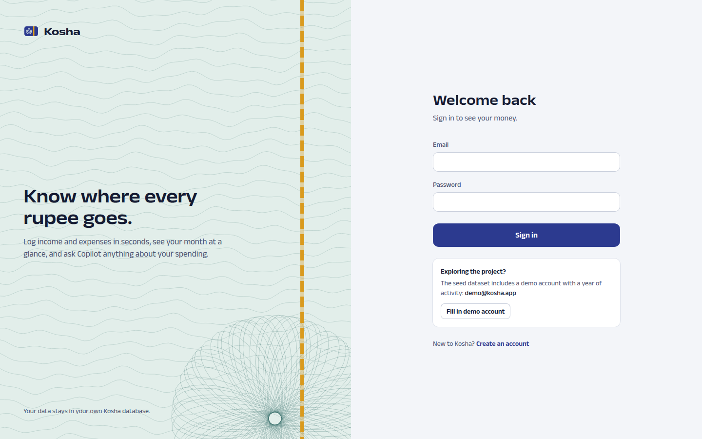

# Kosha: personal finance, in focus

Kosha (Sanskrit for *treasury*) is a full-stack MERN application for logging daily income and expenses.
It shows your balance and the month's totals on one dashboard, charts where the money goes, tracks
monthly budgets, and includes **Kosha Copilot**, an assistant that answers questions about your own data
using the Google Gemini API with function calling. Copilot can also draft transactions and budgets, which
are saved only after you confirm them.



## Features

- **Dashboard:** current balance, the month's income, spending, savings and savings rate (compared with the same days last month), 12-month income vs spending, a ranked category breakdown, a daily spending heatmap, budget meters, recent activity and "what stands out" insights.
- **Transactions:** add, edit and delete with validation; filter by type, category, payment method, date and amount; search; sort; paginate; export to CSV. Filters live in the URL, and deletes can be undone.
- **Analytics:** savings rate by month, spending by weekday, category trends as small multiples, top merchants and a category table over 3, 6 or 12 months.
- **Budgets:** a monthly limit per category with spent, remaining and status (a heads-up at 75%, over budget past 100%), plus copying last month's budgets.
- **Kosha Copilot:** plain-language questions ("Where is my money going?", "Compare this month with last month") answered from your data, with inline charts. Say "Spent 450 on groceries yesterday" and it drafts the entry for you to confirm.
- **Settings:** profile, password, light/dark/system theme, custom categories, and which Copilot engine is active.
- Responsive from 360 px phones (bottom tab bar) to wide desktops, with keyboard support and a table view for every chart.

## Tech stack

| Layer | Technology |
|---|---|
| Database | MongoDB 7 in Docker, Mongoose 8, aggregation pipelines |
| API | Node.js 20+, Express 5, JWT in httpOnly cookies, Zod validation, helmet, rate limiting |
| AI | Google Gemini API via `@google/genai` (function calling over nine Kosha tools) |
| Frontend | React 18, Vite 6, React Router, TanStack Query, React Hook Form, Recharts 3, Tailwind CSS 4 |
| Tests | Vitest, Supertest, React Testing Library, Playwright (system Chrome) |

Money is stored as **integer paise** everywhere (₹450.50 is `45050`), and all reports are bucketed in **Indian Standard Time**.



## Getting started

Prerequisites: Node.js 20 or later, Docker with Compose, and Git.

```bash
git clone https://github.com/biswas2200/financial-managment-mern.git
cd financial-managment-mern
docker compose up -d          # MongoDB + mongo-express; restores the seed dataset on first start
npm install
cp server/.env.example server/.env
npm run dev                   # API on http://localhost:5000, web app on http://localhost:5173
```

Open http://localhost:5173 and sign in with the seed-dataset demo account
(local development only): **demo@kosha.app** / **Demo@1234**. A second account, riya@kosha.app, uses the same password.

mongo-express is available at http://localhost:8081 to browse the database.

### Enable the Gemini engine for Copilot

1. Create a free API key at [Google AI Studio](https://aistudio.google.com/apikey).
2. Put it in `server/.env`:
   ```
   GEMINI_API_KEY=your-key-here
   GEMINI_MODEL=gemini-2.5-flash
   ```
3. Restart `npm run dev`. The Copilot header badge changes from "Offline mode" to "Gemini".

`server/.env` is gitignored, so the key never reaches the repository. Without a key, or when Gemini's
quota is exhausted or unreachable, Copilot answers with its built-in rule-based engine using the same tools.
When Gemini is enabled, your question and the figures Copilot looks up are sent to Google to write the reply.

## Scripts

| Command | What it does |
|---|---|
| `npm run dev` | API (watch mode) and Vite dev server together |
| `npm test` | Shared, server and client test suites |
| `npm run test:coverage` | Server and client tests with coverage |
| `npm run e2e` | Playwright end-to-end journeys in Google Chrome (starts the dev servers if needed) |
| `npm run seed` / `npm run seed:fresh` | Recreate the demo accounts / drop the database and reseed |
| `npm run db:dump` | Write the database to `database/dump/kosha.archive.gz` |
| `npm run db:reset` | Recreate the MongoDB volume (restores the committed dump) |
| `npm run screenshots` | Capture every screen into `docs/report/screenshots` |
| `npm run build` | Production build of the web app |

The server tests use a separate `kosha_test` database in the same Docker container, so `docker compose up -d` must be running.

## Testing

Development followed test-driven development: each feature started with a failing test committed as
`test(...): ... (red)`, followed by the implementation as `feat(...): ... (green)`.

| Suite | Tests | Notes |
|---|---|---|
| shared | 62 | money parsing and formatting, IST dates, validation schemas |
| server | 153 | unit (parser, intents, Gemini loop, seed) and API integration against MongoDB, 89% statement coverage |
| client | 28 | API client, filter reducer, transaction form, KPI strip, Copilot draft card |
| e2e | 10 | sign-up, CRUD and dashboard totals, filters, undo, validation, Copilot confirm, budgets |

## Project structure

```
shared/      money utils, IST date helpers, category catalog, Zod schemas (used by server and client)
server/      Express API
  src/models        User, Category, Transaction, Budget, AssistantMessage
  src/services      business rules and aggregation pipelines
  src/agent         Copilot: tools, Gemini provider, offline engine, insights
  scripts/          seed.js, dump.sh
  tests/            unit and integration suites
client/      React app (features/, components/, api/, styles/)
e2e/         Playwright specs and the screenshot script
database/    initdb restore script and the committed seed dump
docs/report/ project report, diagrams, screenshots and test evidence
```

## API overview

All routes are under `/api/v1` and return JSON; everything except `/auth` needs a session.

| Resource | Endpoints |
|---|---|
| Auth | `POST /auth/register`, `POST /auth/login`, `POST /auth/logout`, `GET/PATCH /auth/me`, `POST /auth/change-password` |
| Categories | `GET/POST /categories`, `PATCH/DELETE /categories/:id` |
| Transactions | `GET/POST /transactions`, `GET/PATCH/DELETE /transactions/:id`, `GET /transactions/export.csv` |
| Budgets | `GET/PUT /budgets`, `POST /budgets/copy`, `DELETE /budgets/:id` |
| Analytics | `GET /analytics/summary`, `/by-category`, `/trend`, `/daily`, `/weekday`, `/merchants`, `/category-trend` |
| Copilot | `GET /assistant/status`, `/insights`, `GET/DELETE /assistant/history`, `POST /assistant/message`, `POST /assistant/actions/:id/confirm` and `/cancel` |

## Screenshots

| | |
|---|---|
|  |  |
|  |  |
|  |  |

## Troubleshooting

- **"Could not connect to MongoDB"**: start the database with `docker compose up -d`.
- **Empty dashboard after cloning**: the dump restores only on a fresh volume. Run `npm run db:reset` or `npm run seed:fresh`.
- **Port already in use**: the API uses `API_PORT` (default 5000) from `server/.env`; Vite uses 5173.

## Project report

The MCA project report (25MCA301) is in [`docs/report`](docs/report): `Kosha_Project_Report.docx`, the diagrams and the test evidence.
