# Kosha: personal finance, in focus

Kosha (Sanskrit for *treasury*) is a full-stack MERN application for logging daily income and expenses.
It shows your balance and the month's totals on one dashboard, charts where the money goes, tracks
monthly budgets, and includes **Kosha Copilot**, an assistant that answers questions about your own data
using the Google Gemini API with function calling. Copilot can also draft transactions and budgets, which
are saved only after you confirm them.

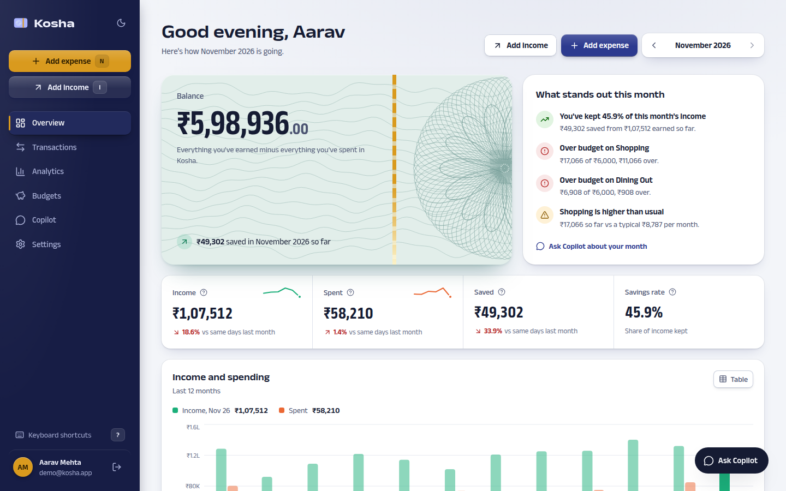

## Features

- **Dashboard:** current balance, the month's income, spending, savings and savings rate (compared with the same days last month), 12-month income vs spending, a ranked category breakdown, a daily spending heatmap, budget meters, recent activity and "what stands out" insights.
- **Transactions:** add, edit and delete with validation; filter by type, category, payment method, date and amount; search; sort; paginate; export to CSV. Filters live in the URL, and deletes can be undone.
- **Analytics:** savings rate by month, spending by weekday, category trends as small multiples, top merchants and a category table over 3, 6 or 12 months.
- **Budgets:** a monthly limit per category with spent, remaining and status (a heads-up at 75%, over budget past 100%), plus copying last month's budgets.
- **Kosha Copilot:** plain-language questions ("Where is my money going?", "Compare this month with last month") answered from your data, with inline charts. Say "Spent 450 on groceries yesterday" and it drafts the entry for you to confirm.
- **Going back in time:** click the month name for a grid of months, click a month on the 12-month chart, or step with the arrows. Months from before you signed up show the calendar but no insights, and you can fill them in.
- **Click a day:** the spending calendar lists what you spent that day and lets you add an expense dated that day.
- **A balance you can trust:** if spending outruns income the balance goes below zero and says why. Type what you really have (a minus sign is fine for an overdraft), or try the clearly labelled demo bank, which fetches a sample figure. Your transactions are never rewritten.
- **Budgets with your own categories:** every expense category can be picked, and a new category with its own icon (55+ to choose from) can be made without leaving the budget form.
- **Settings:** profile picture (an icon on a colour, or your own photo shrunk in the browser), phone number, date of birth, password, light/dark/system theme, custom categories, what you agreed to, deleting your account, and which Copilot engine is active.
- **Privacy:** a plain-language Privacy Policy and Terms of Use, accepted at sign-up and recorded with the version and time. Phone number and date of birth are optional.
- Responsive from 360 px phones (bottom tab bar and account menu) to wide desktops, with keyboard support and a table view for every chart.
- **Installable app (PWA):** add Kosha to a phone's home screen or a desktop dock. It opens full screen, starts offline, and has "Add expense" and "Add income" shortcuts on the app icon.

### Designed to be easy to use

- **Getting started checklist:** new accounts see four steps (add income, log an expense, set a budget, ask Copilot) that tick themselves off from real data.
- **Fast entry:** "Add expense" and "Add income" buttons everywhere. Only the amount and a category are required; categories and payment methods are one-tap chips, the date has Today/Yesterday shortcuts, and the description fills itself from the merchant or category.
- **Calmer filters:** search, type and a "When" menu (This month, Last month, Last 30 days) up front; everything else under "More filters", with every active filter shown as a removable chip.
- **Plain-language help:** a "?" next to terms like Savings rate explains what they mean.
- **Accessible:** WCAG AA text contrast in both themes, labelled controls, a focus ring that eases in, themed dropdowns that work from the keyboard, a show/hide toggle on password fields.

### Depth and motion

- **Tactile surfaces:** cards are raised paper with a top-edge highlight and ink-tinted shadows, inputs and toggles are pressed-in wells, and buttons are bevelled keys that sink when you press them. A dark indigo rail holds the navigation.
- **The banknote:** the balance card tips towards your mouse in 3D, a sheen follows the light and the security thread glints like foil.
- **Motion with a reason:** the balance and monthly figures count up, dashboard panels rise in sequence on load, and dialogs, menus, chips, toasts and page changes animate to show what changed. All of it switches off when the system asks for reduced motion.

### Keyboard shortcuts

| Key | Action |
|---|---|
| `N` | Add an expense |
| `I` | Add income |
| `/` | Search transactions |
| `?` | Show all shortcuts |
| `Esc` | Close a dialog or menu |

## Tech stack

| Layer | Technology |
|---|---|
| Database | MongoDB 7 in Docker, Mongoose 8, aggregation pipelines |
| API | Node.js 20+, Express 5, JWT in httpOnly cookies, Zod validation, helmet, rate limiting |
| AI | Google Gemini API via `@google/genai` (function calling over nine Kosha tools) |
| Frontend | React 18, Vite 6, React Router, TanStack Query, React Hook Form, Recharts 3, Tailwind CSS 4 |
| Tests | Vitest, Supertest, React Testing Library, Playwright (system Chrome) |

Money is stored as **integer paise** everywhere (₹450.50 is `45050`), and all reports are bucketed in **Indian Standard Time**.

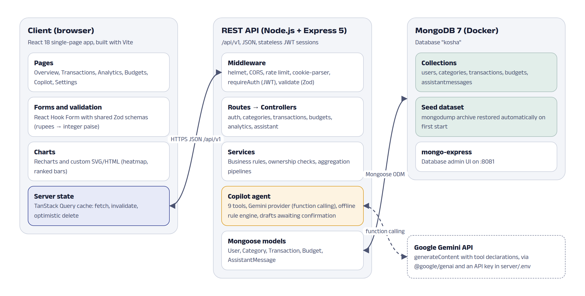

## Getting started

Prerequisites: Node.js 20 or later, Docker with Compose, and Git.

```bash
git clone https://github.com/biswas2200/financial-managment-mern.git
cd financial-managment-mern
docker compose up -d          # MongoDB + mongo-express; restores the seed dataset on first start
npm install
cp server/.env.example server/.env
npm run dev                   # API on http://localhost:5000, web app on http://localhost:5173
```

Open http://localhost:5173 and sign in with the seed-dataset demo account
(local development only): **demo@kosha.app** / **Demo@1234**. A second account, riya@kosha.app, uses the same password.

mongo-express is available at http://localhost:8081 to browse the database.

### Use it on your phone (PWA)

```bash
npm run pwa        # production build on http://localhost:4173 with the API, reachable on your network
```

- **On the laptop:** open http://localhost:4173 in Chrome or Edge and choose **Install Kosha app** in the sidebar (or the install icon in the address bar).
- **On a phone on the same Wi-Fi:** open `http://<your-laptop-ip>:4173` (Vite prints the Network address). Browsers only allow installing and offline mode over HTTPS or localhost, so on a plain LAN address Kosha works as a normal mobile website. To install it on the phone, serve it over HTTPS (for example with a tunnel such as `cloudflared tunnel --url http://localhost:4173`) and use **Add to Home Screen**.
- `npm run dev:lan` is the same as `npm run dev` but reachable from other devices, for testing layouts on a real phone.

The service worker caches only the app shell (HTML, scripts, styles, icons, fonts). Balances and transactions always come live from the API and are never cached on the device.

### Enable the Gemini engine for Copilot

Pick one of two ways to sign in to Google Gemini.

**A. An API key**

1. Create a free API key at [Google AI Studio](https://aistudio.google.com/apikey).
2. Put it in `server/.env`:
   ```
   GEMINI_API_KEY=your-key-here
   GEMINI_MODEL=gemini-2.5-flash
   ```

**B. Google Application Default Credentials (no key stored anywhere)**

1. Sign in once on your machine: `gcloud auth application-default login`.
2. Enable Vertex AI on your project: `gcloud services enable aiplatform.googleapis.com`.
3. Tell Kosha which project to use in `server/.env`:
   ```
   GOOGLE_CLOUD_PROJECT=your-project-id
   GOOGLE_CLOUD_LOCATION=us-central1
   GEMINI_AUTH=adc
   ```
   On Google Cloud (Cloud Run, GCE) the attached service account is picked up the same way, with no `gcloud` login.

Restart `npm run dev`. The Copilot header badge changes from "Offline mode" to "Gemini", and Settings says which sign-in is in use.
An API key wins when both are set, unless `GEMINI_AUTH=adc`.

`server/.env` is gitignored, so nothing secret reaches the repository. Without Gemini configured, or when Gemini's
quota is exhausted or unreachable, Copilot answers with its built-in rule-based engine using the same tools.
When Gemini is enabled, your question and the figures Copilot looks up are sent to Google to write the reply.

## Scripts

| Command | What it does |
|---|---|
| `npm run dev` | API (watch mode) and Vite dev server together |
| `npm run dev:lan` | The same, reachable from phones on your network |
| `npm run pwa` | Production build plus API on :4173, installable as an app |
| `npm test` | Shared, server and client test suites |
| `npm run test:coverage` | Server and client tests with coverage |
| `npm run e2e` | Playwright end-to-end journeys in Google Chrome (starts the dev servers if needed) |
| `npm run seed` / `npm run seed:fresh` | Recreate the demo accounts / drop the database and reseed |
| `npm run db:dump` | Write the database to `database/dump/kosha.archive.gz` |
| `npm run db:reset` | Recreate the MongoDB volume (restores the committed dump) |
| `npm run screenshots` | Capture every screen into `docs/report/screenshots` |
| `npm run build` | Production build of the web app |

The server tests use a separate `kosha_test` database in the same Docker container, so `docker compose up -d` must be running.

## Testing

Development followed test-driven development: each feature started with a failing test committed as
`test(...): ... (red)`, followed by the implementation as `feat(...): ... (green)`.

| Suite | Tests | Notes |
|---|---|---|
| shared | 79 | money parsing and formatting, IST dates, validation schemas, phone, date of birth, avatar and balance rules |
| server | 184 | unit (parser, intents, Gemini loop and sign-in, seed) and API integration against MongoDB: profile, consent, balance, account deletion |
| client | 171 | API client, filters, forms, dropdown, month picker, calendar, balance dialog, avatar and date-of-birth inputs, policy pages, menus, hotkeys, 3D tilt and count-up, PWA |
| e2e | 43 | sign-up and consent, CRUD and dashboard totals, filters, undo, Copilot confirm, budgets and custom categories, months and days, balance, profile, phone layout |

## Project structure

```
shared/      money utils, IST date helpers, category catalog, Zod schemas (used by server and client)
server/      Express API
  src/models        User, Category, Transaction, Budget, AssistantMessage
  src/services      business rules and aggregation pipelines
  src/agent         Copilot: tools, Gemini provider, offline engine, insights
  scripts/          seed.js, dump.sh
  tests/            unit and integration suites
client/      React app (features/, components/, api/, pwa/, styles/); public/ holds the manifest, icons and sw.js
e2e/         Playwright specs and the screenshot script
database/    initdb restore script and the committed seed dump
docs/report/ project report, diagrams, screenshots and test evidence
```

## API overview

All routes are under `/api/v1` and return JSON; everything except `/auth` needs a session.

| Resource | Endpoints |
|---|---|
| Auth | `POST /auth/register`, `POST /auth/login`, `POST /auth/logout`, `GET/PATCH/DELETE /auth/me`, `POST /auth/change-password` |
| Categories | `GET/POST /categories`, `PATCH/DELETE /categories/:id` |
| Transactions | `GET/POST /transactions`, `GET/PATCH/DELETE /transactions/:id`, `GET /transactions/export.csv` |
| Budgets | `GET/PUT /budgets`, `POST /budgets/copy`, `DELETE /budgets/:id` |
| Balance | `GET/PUT /balance`, `GET /balance/banks`, `POST /balance/bank-demo` (sample figures, nothing is connected) |
| Analytics | `GET /analytics/summary`, `/by-category`, `/trend`, `/daily`, `/weekday`, `/merchants`, `/category-trend` |
| Copilot | `GET /assistant/status`, `/insights`, `GET/DELETE /assistant/history`, `POST /assistant/message`, `POST /assistant/actions/:id/confirm` and `/cancel` |

## Screenshots

| | |
|---|---|
| 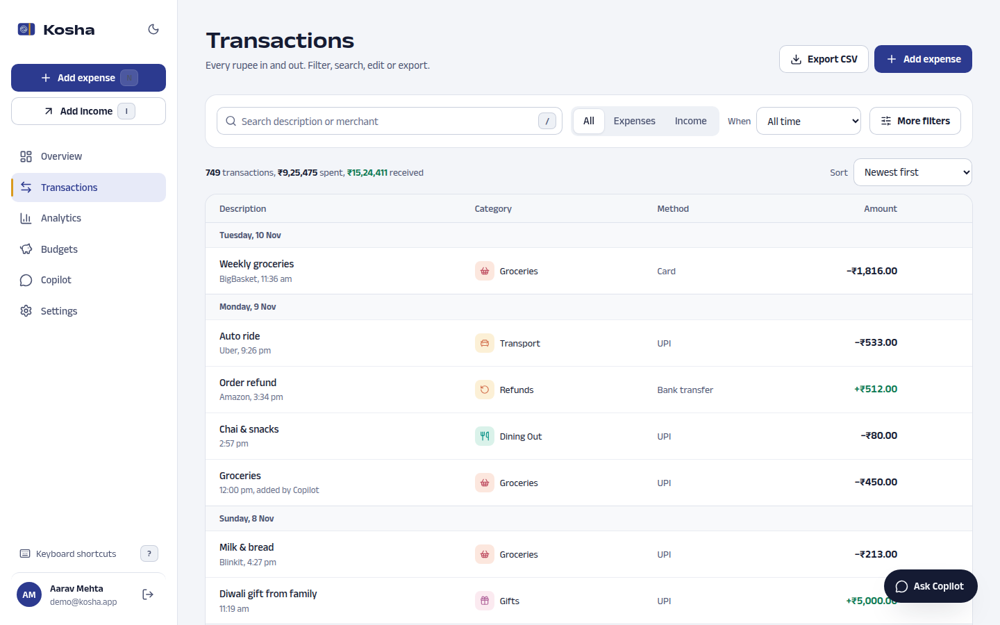 | 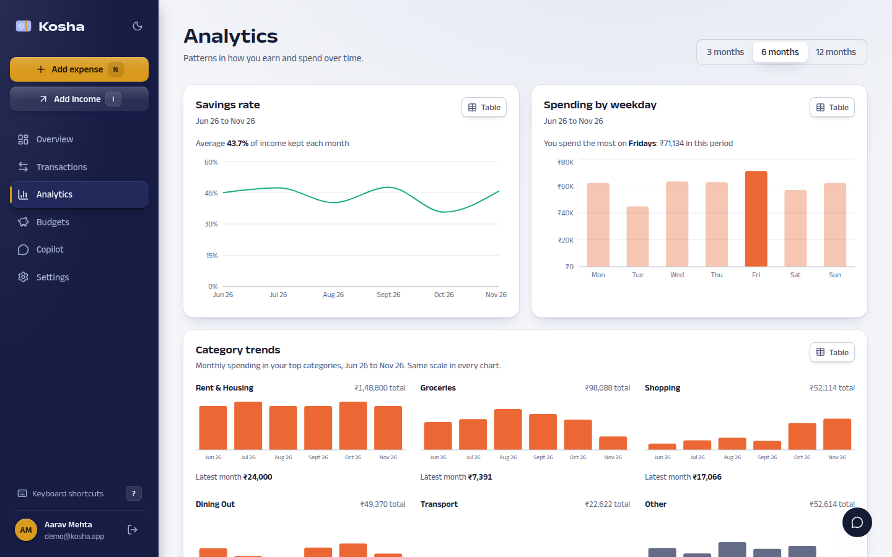 |
| 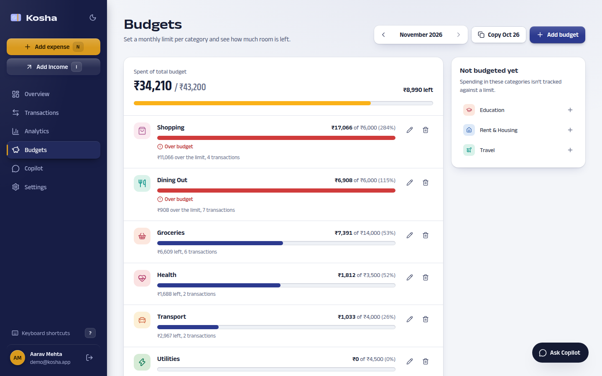 | 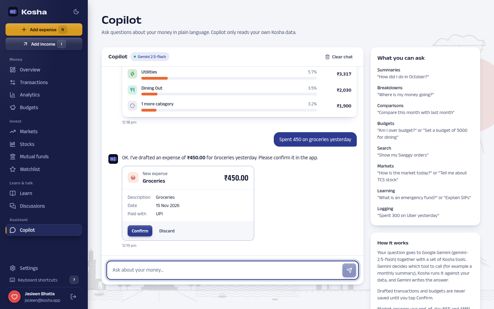 |
| 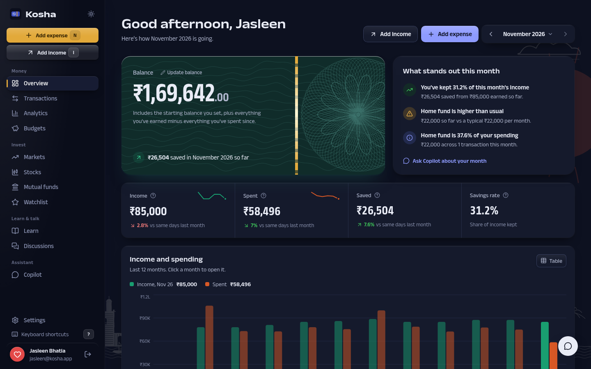 | 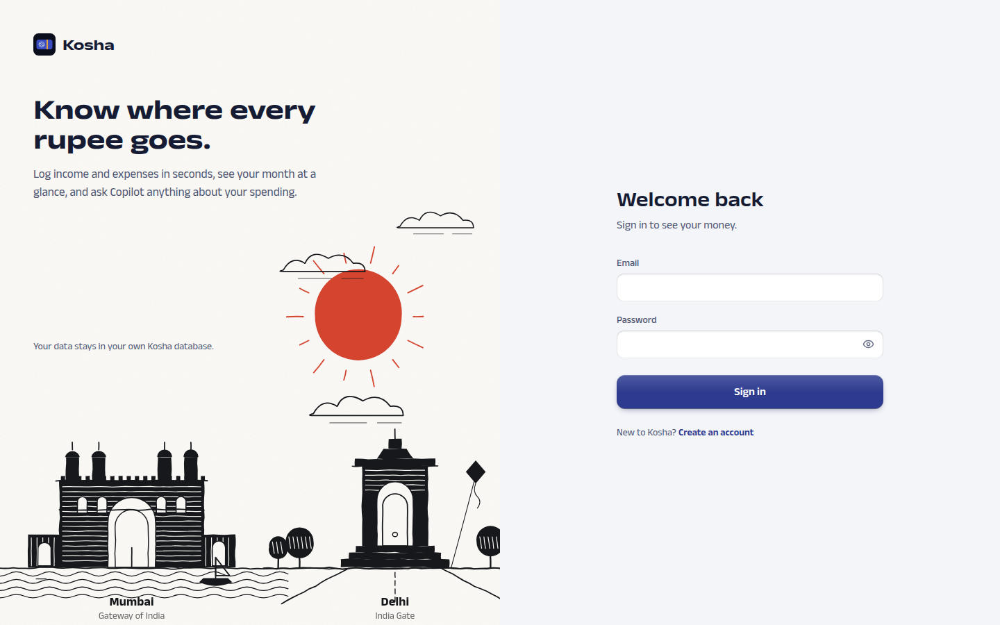 |
| 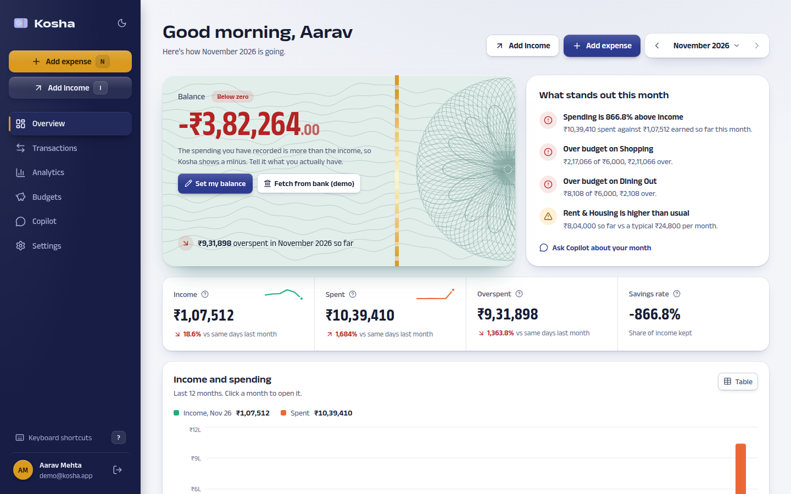 | 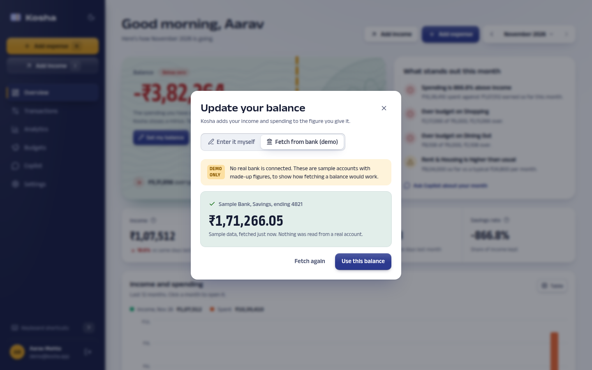 |
| 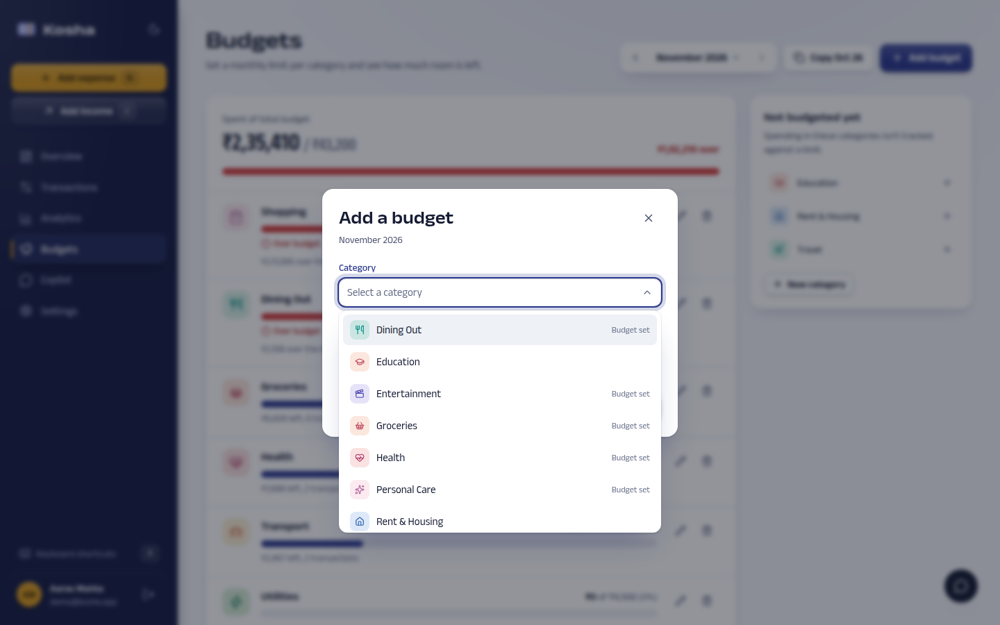 | 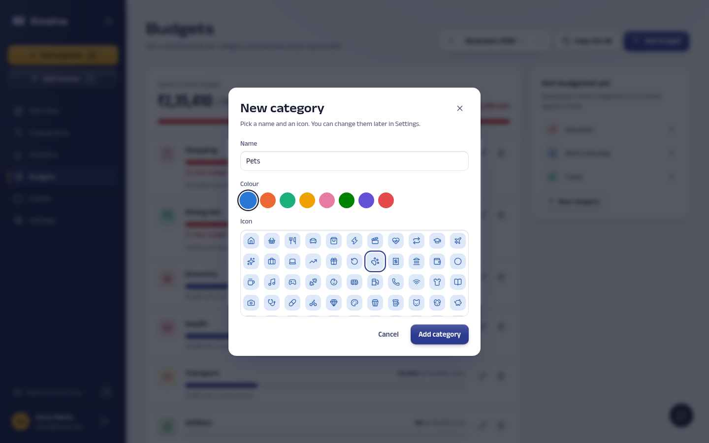 |
| 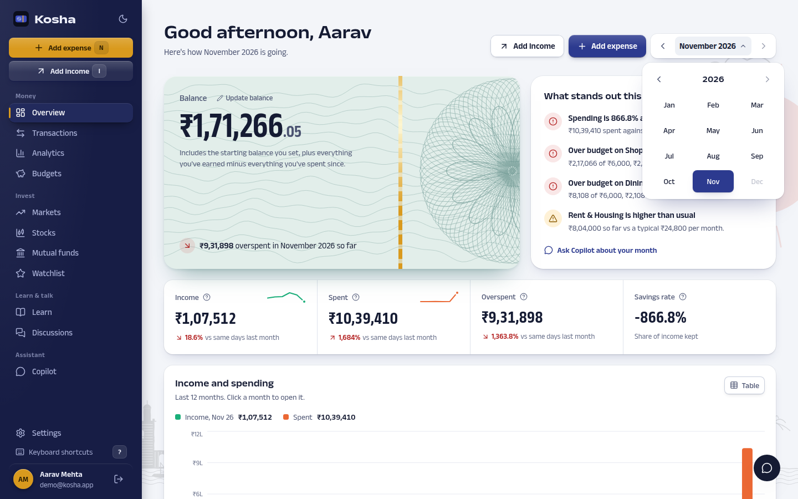 | 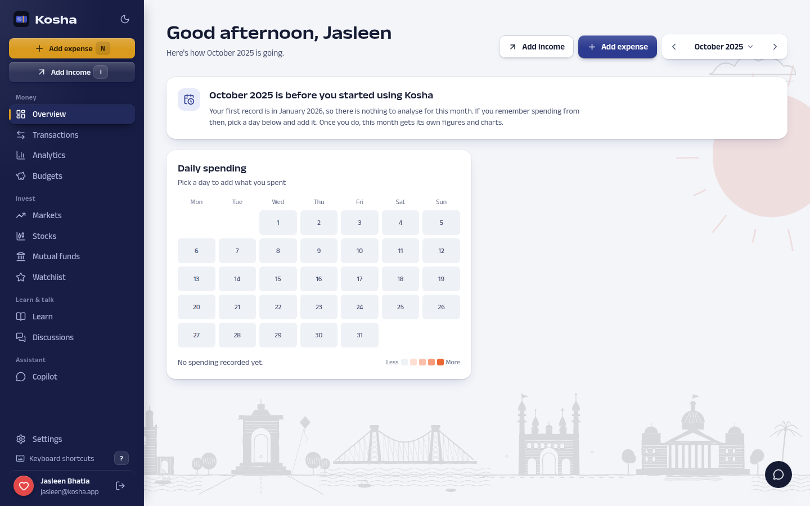 |
| 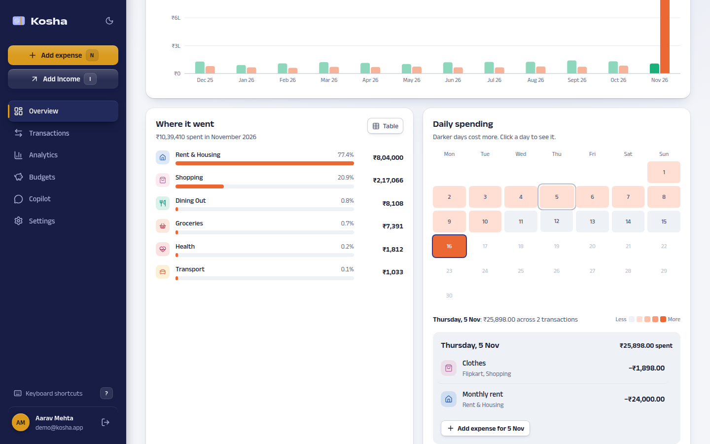 | 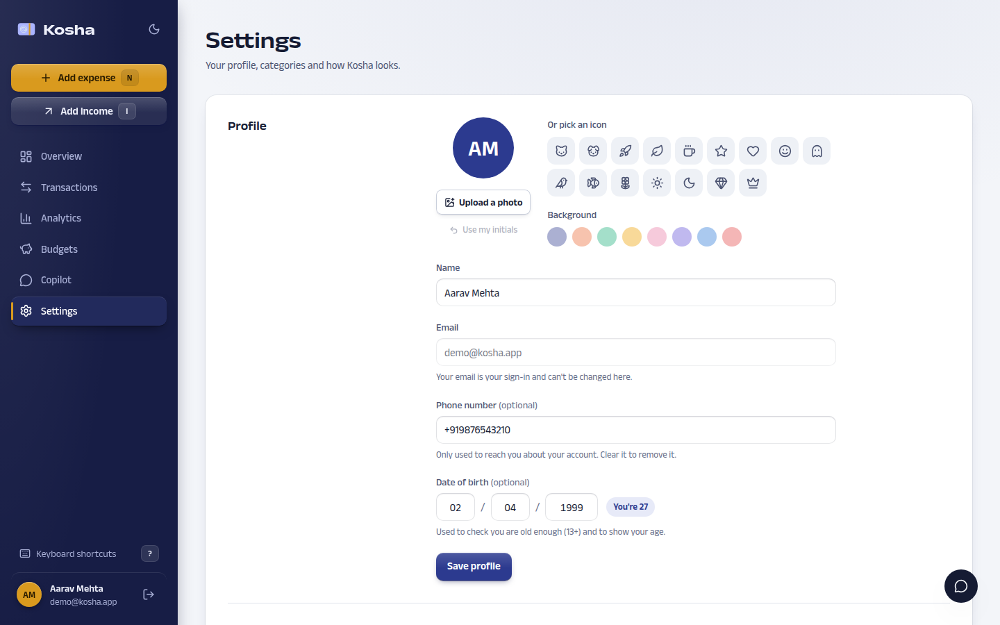 |
| 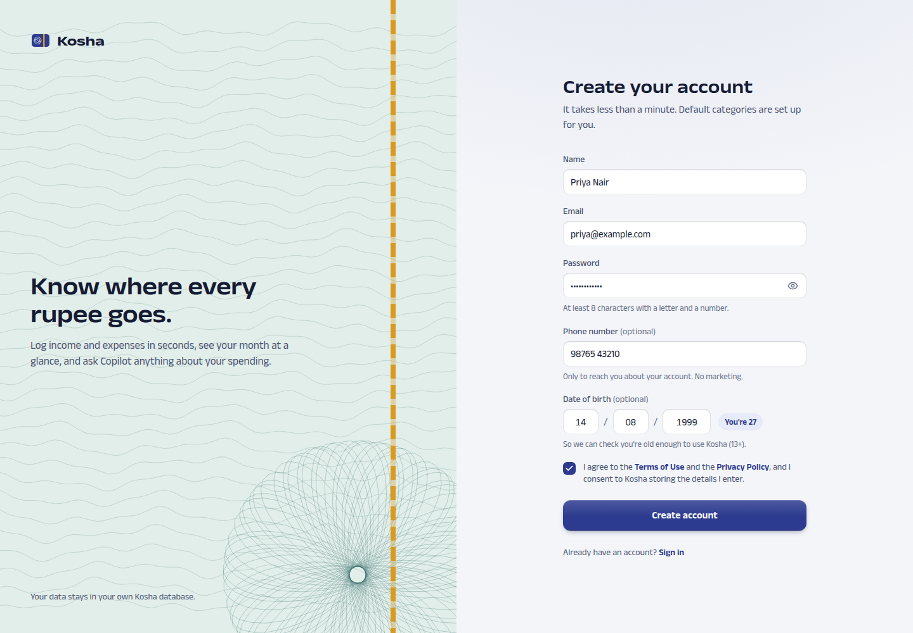 | 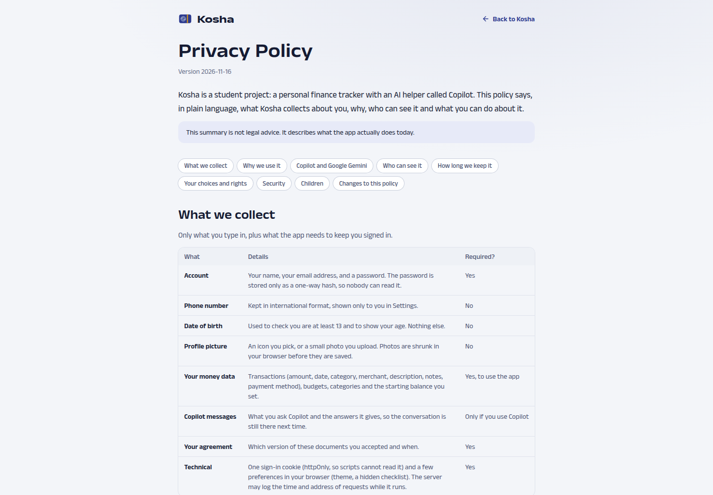 |

## Troubleshooting

- **"Could not connect to MongoDB"**: start the database with `docker compose up -d`.
- **Empty dashboard after cloning**: the dump restores only on a fresh volume. Run `npm run db:reset` or `npm run seed:fresh`.
- **Port already in use**: the API uses `API_PORT` (default 5000) from `server/.env`; Vite uses 5173.

## Project report

The MCA project report (25MCA301) is in [`docs/report`](docs/report): `Kosha_Project_Report.docx`, the diagrams and the test evidence.
